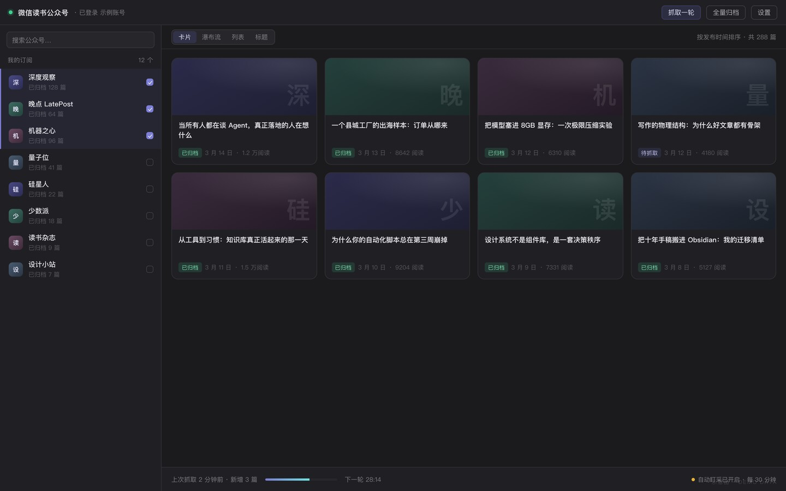

<div align="center">
  
</div>

<h1 align="center">
  
</h1>

<p align="center">
  <b>微信读书公众号盯采</b> · 一次扫码，把你书架里订阅的公众号文章，自动搬进 Obsidian。
</p>

<p align="center">
  <a href="README_EN.md">English</a> ·
  <a href="#三分钟上手">快速开始</a> ·
  <a href="#登录状态怎么看">登录状态</a> ·
  <a href="#常见问题">常见问题</a> ·
  <a href="https://github.com/pixelxzen/Zisuzi-Weread-MP/issues">反馈问题</a>
</p>

<p align="center">
  <a href="https://github.com/pixelxzen/Zisuzi-Weread-MP/releases"></a>
  <a href="https://github.com/pixelxzen/Zisuzi-Weread-MP/releases"></a>
  
  
  <a href="LICENSE"></a>
</p>

---

公众号的文章，天生是「读完就散」的：散在订阅号信息流里、散在微信收藏里、散在转发到各个群的聊天记录里。
你想留住的那些长文、那些行业观察、那些写得比书还扎实的深度稿，最后大多只剩一个失效的链接。

**这个插件只做一件事，并把这件事做干净：把你微信读书书架里已经订阅的公众号，按你设定的节奏盯住，有更新就抓下来，连同图片和音视频，落成你自己的 Markdown 笔记。**

- 数据直连**你自己的**微信读书账号，不经任何第三方服务器中转
- 不碰微信客户端，不破解任何服务，不做账号池
- 全部免费（唯一的可选开销，是你自己配置的大模型 token）

```
微信读书书架  ──▶  插件盯采  ──▶  Obsidian 笔记库
  订阅的公众号        定时 / 手动        正文 + 图片 + 音视频 + 元数据
```

## 为什么值得装

| 你现在的处境 | 装上之后 |
|---|---|
| 想留存的文章躺在信息流里，翻两屏就再也找不到 | 按公众号归档，目录结构一眼看清楚 |
| 手动复制到 Obsidian，图片一张张丢 | 图片自动下载到本地 `assets/`，中文文件名也不出错 |
| 收藏了一堆链接，半年后全部 404 | 正文全文落盘，链接失效也不影响你手里的笔记 |
| 播客、视频号内容只能看不能存 | 音视频解析直链下载，用原生播放器嵌进笔记 |
| 想批量回看某个号的历史文章 | 单号全量归档，从新到旧整批抓，失败可单篇重试 |

## 功能

| | |
|---|---|
| **扫码登录** | 插件内嵌登录窗口，微信扫一下即可，不需要手工复制 Cookie |
| **书架即订阅源** | 自动读取你微信读书书架里订阅的公众号（几百个也能搜），勾选要盯的号 |
| **自动盯采** | 按设定间隔轮询，新文章自动落盘；状态条显示进度、倒计时、上次收了几篇 |
| **单号全量归档** | 把一个号的历史文章从新到旧整批抓下来，逐篇显示状态，失败可单独重试 |
| **正文完整归档** | HTML → Markdown；图片按魔数判真扩展名（微信 CDN 常把 PNG 挂在 `.jpg` 下） |
| **音视频落盘** | 解析直链并下载，用 `<audio>` / `<video>` 原生播放器嵌进笔记 |
| **四种视图** | 卡片网格 / 瀑布流 / 列表 / 纯标题，按需切换；左侧常驻公众号导航栏 |
| **两套主题** | Linear 中性 / 紫苏子品牌，一键切换 |
| **AI 处理** | 可接任意 OpenAI 兼容端点（内置 DeepSeek 等预设），对单篇做摘要、提炼金句、写评论，结果一键写回笔记 |
| **本地 Agent** | 可选调用本机 CLI（Hermes / Claude Code / Codex / Kimi / Gemini / Cursor）处理文章，不联网上传 |

> AI 处理与本地 Agent **默认全部关闭**，需要你显式开启并填入自己的 Key / 命令。


## 界面一览

<div align="center">
  
  <br />
  <sub>界面示意 · 示例数据。账号与文章均为虚构，实际界面以你安装的版本为准。</sub>
</div>

- **顶部**：登录状态 + 一站式操作（抓取一轮 / 全量归档 / 设置）
- **左侧**：公众号导航栏，勾选即盯，已归档篇数直接显示
- **中间**：卡片 / 瀑布流 / 列表 / 标题四种视图，文章卡片带归档状态
- **底部**：上次抓取结果、进度、下一轮倒计时，自动盯采状态一目了然

## 三分钟上手

**1. 安装**

`设置 → 第三方插件 → 浏览 → 搜索「Zisuzi-Weread-MP」` → 安装 → 启用。

手动安装：从 [Releases](https://github.com/pixelxzen/Zisuzi-Weread-MP/releases) 下载 `main.js`、`manifest.json`、`styles.css`，放进 `<你的库>/.obsidian/plugins/zisuzi-weread-mp/`，然后在「第三方插件」里重新加载并启用。

**2. 扫码登录**

`设置 → Zisuzi-Weread-MP` → 点 **扫码登录** → 在弹出的窗口里用微信扫一下。
登录成功后窗口自动关闭，头像、昵称、书架全部自动就位。

**3. 选号**

回到插件主界面，左侧勾选你要盯的公众号。几百个号也能直接搜。

**4. 开跑**

点 **抓取一轮** 立刻试一次；或打开 **自动盯采**，让它按间隔自己跑。

> 首次同步书架需要几秒到十几秒，取决于你订阅了多少个号。想先看效果，可以挑一个更新勤的号做「全量归档」。

## 登录状态怎么看

设置页登录卡片上有一个小圆点。它只表达一件事：**网页登录态这次实测能不能用**。颜色含义是固定的：

| 颜色 | 含义 | 你该做什么 |
| --- | --- | --- |
| 🟢 绿 | 列表接口实测可用，抓取正常 | 不用管 |
| 🟡 琥珀 | 登录本身有效，但「公众号接口」对这个账号限流（`-2041`） | **别重新扫码**（扫码不会改善）：用手机微信读书 App 打开一次该公众号文章，或等 24 小时 |
| 🔴 红 | 网页登录态失效（cookie 缺项或过期，通常是 `-2012`） | 点「重新扫码」 |
| ⚪ 灰 | 还没测过 | 打开设置页会自动测一次，也可以点「测试列表」 |

三层东西互不替代，别混着看：

| 层 | 决定什么 | 失效时的样子 |
| --- | --- | --- |
| 官方 Key（`wrk-…`） | 书架、书籍元数据能不能读 | Key 缺失，重新扫码换一个 |
| 网页登录态（`wr_vid` / `wr_skey` / `wr_rt` / `wr_gid`） | 公众号文章列表、正文、图片与音视频能不能抓 | 变红，需要重新扫码 |
| 账号本身 | 服务端是否对这个账号限流 | 变琥珀，扫码无用 |

**曾经出现过的「绿点 + 未检测」自相矛盾**：早期那个点判的是「凭据字段写全了没有」，不是「服务端认不认」，两件事排在一起就读不通。现在绿点只来自真实接口结论，没测过一律灰。

## 加载不出文章？先对号入座

出现「加载失败 / 列表是空的 / 提示风控码」时，先看插件设置页**最上面那条结论**——它已经把原因翻成了人话。下面是把那条结论拆开讲。

先说结论：**微信读书有两条完全不同的失败路径，处理方式相反。搞混了会越弄越糟。**

| 你看到的 | 真实原因 | 该做什么 | 千万别做 |
| --- | --- | --- | --- |
| `-2041`（琥珀点）「公众号接口受限」 | 这个**账号**被限制了「公众号文章列表」这一个接口。登录、书架、公众号详情全都正常 | 用手机微信读书 App 打开任一公众号文章（弹滑动验证就划一下）→ 回插件点「手机 App 验证过了，立即解除」 | ❌ **不要重新扫码**。扫码换的是登录态，换不来接口权限，只会多撞一次风控 |
| `-2012` / `-2010`（红点）「登录态失效」 | 会话真的过期（或长期撞 `-2041` 后被连带判失效） | 设置 → 退出登录 → 扫码登录 | ❌ 不要在冷却期内反复点刷新 |
| 「今日额度用完」 | 插件主动刹车，账号本身没问题 | 明天再抓；已归档的笔记不受影响 | ❌ 不要为了马上抓去改大额度和间隔 |
| 某个号列表空、其他号正常 | 微信读书没收录这个号的文章 | 在微信读书 App 打开一次该号任意文章，再点「同步书架」 | — |

### 30 秒自己确认一次

不用猜，用同一份登录态打两个接口对比就行：

```bash
# ① 登录态：正常会返回 {"userVid":…,"name":"你的昵称",…}
curl -s "https://weread.qq.com/web/user?userVid=<你的VID>" \
  -H "Cookie: <设置页「高级」里的 cookie>" -H "Referer: https://weread.qq.com/"

# ② 公众号列表：-2041 就是从这一步来的
curl -s "https://weread.qq.com/web/mp/articles?bookId=MP_WXS_xxxx&offset=0" \
  -H "Cookie: <同一个 cookie>" -H "Referer: https://weread.qq.com/web/mp/MP_WXS_xxxx"
```

| 结果 | 结论 |
| --- | --- |
| ① 有昵称，② 报 `-2041` | **登录没问题**，账号被限制，按上表第一行处理 |
| ① 也报 `-2010` / `-2012` | 登录态真过期了：退出重登 |
| ①、② 都正常但没文章 | 这个号没被微信读书收录 |

> 这两条命令只在你本机跑，别把 cookie 贴到任何聊天窗口或公开仓库——它等价于你的登录凭据。

### 为什么会被限，多久恢复

公众号文章列表是微信读书的**私有接口**，官方没有开放文档。社区长期实测的安全线大致是：

> 每个微信读书账号约 **10 个公众号 × 每天刷新 2 次**（≈ 20 次列表请求/天）。

超了先弹滑动验证码，持续超就进「小黑屋」，通常按 **24 小时**解封。4.5.0 起插件把这个经验写成了硬预算与冷却，见下一节。

## 抓取节奏与风控红线

公众号接口是私有接口，**过度请求会被限**。4.5.0 的默认值是按上面那条安全线倒推的：

| 参数 | 默认 | 为什么是这个数 |
|---|---|---|
| 轮询间隔 | **240 分钟** | 3 个号 × 每天 6 轮 ≈ 18 次列表请求，落在 20 次安全线内 |
| 每轮文章上限 | **3 篇** | 正文请求单独计数，超了同样会被限 |
| 单号每轮上限 | 2 篇 | 多号盯采时把请求摊开 |
| 列表间隔 | 1.2 秒 | 相邻两次列表请求之间 |
| 正文间隔 | 2.5 秒 | 相邻两次正文请求之间 |

**号越多，间隔就要越长。** 换算参考：

| 已选公众号 | 建议轮询间隔 | 每天列表请求 |
|---|---|---|
| 1–3 个 | 240 分钟（默认） | ≈ 18 |
| 4–6 个 | 360 分钟 | ≈ 20 |
| 7–10 个 | 480 分钟 | ≈ 24（到边缘了） |
| 10 个以上 | 分账号，或只用「手动抓取一轮」 | — |

### 插件替你守的三道闸（4.5.0）

1. **每日预算**：列表、正文分别按「已选号数 × 20」给额度，超了直接停手，并明确告诉你这是额度问题、不是账号出问题。
2. **冷却 + 指数退避**：撞一次 `-2041` 冷却 60 分钟；再撞 120 / 240 / 480 分钟翻倍封顶；抓到一次正常列表就自动清零。
3. **冷却期内不打接口**：点刷新、自动更新、打开设置页自动探测，全部拦住，避免「每小时试一次 = 每小时撞一次」。

> 命中 `-2010` / `-2012` / `-2041` 时插件**立即停止、不自动重试**，并自动暂停自动更新。
> 请不要为了「快」把间隔改小。代价是你的微信读书账号被限，不是插件崩了。

### 单号历史能翻到最早那一篇吗？

能。左侧点中某个号之后，**往下滚就会自动续拉**，一直滚到该号最早的一篇；到底时底部显示
`已经到底了 · 共 N 篇 · 最早 YYYY-MM-DD`。这一行只在**服务端真的返回了空页**后才出现，不是猜的。

4.5.1 修掉的两个实测坑（都验证过真实数据）：

| 现象 | 原因 | 现在 |
|---|---|---|
| 只加载 20 篇就显示「已经到底了」，怎么滚都不动 | 旧逻辑把「一页少于 20 条」当成最后一页；可这个接口会因服务端过滤少返回，实测同一天内见过 **20 / 19 / 9 条** 三种页长 | 只有返回 **0 条**才封底 |
| 翻到中间重复出现同一篇，后面还可能漏 | 旧逻辑按「返回条数」推进 offset（20 → 39 → …），而服务端是按 **20 个槽位**分页；`offset=39` 会重复返回上一页最后那条 | offset 固定 +20 推进 |
| 翻得太急，突然所有号都加载不出来并提示 `-2012 登录超时` | 短时间密集请求会被判会话超时（实测 1 分钟内 10 次列表请求就中） | 单页 ≥2.5 秒、每分钟 ≤8 次，超了自动等一轮并提示「翻页太快」 |

> 一个几百篇的大号会被平滑降速而不是一次拉完 —— 这是故意的：宁可多滚几次，也别把会话打死。
> 如果确实要一次性归档全部历史，用命令面板里的「归档某个号的全部历史（分批 · 防风控）」，它自带分批与休息。

### 「单批上限」和「待抓」是什么关系？

这两个不是同一件事，但很容易看错：

| 名词 | 含义 | 会不会影响别的文章 |
|---|---|---|
| **单批上限**（默认 30 篇） | **本次运行最多下载多少篇正文** | 不会。它不标记、不改状态，只是「这一轮到此为止」 |
| **待抓** | 该文章**已发现在列表里，但本地还没有对应的笔记文件** | 与单批上限无关：任何「发现但没落盘」的文章都是待抓 |

所以「48 篇的号只跑了 30 篇，剩下 18 篇变成待抓」—— 准确说法是：**剩下 18 篇本来就是待抓，这一批轮到它们的额度用完了**。

**怎么把一个号完整跑完**（4.5.2 起）：

1. 点「开始归档」跑第一批（默认 30 篇）；
2. 跑完后如果还有剩余，窗口底部会出现 **`继续下一批（还有 N 篇）`** —— 点它接着跑；
3. 篇数很多（几百篇）时，可以勾上 **`连续跑`**，插件会每批间隔 10 分钟自动接着跑，直到该号全部归档；
4. 明细里每一行都会从 `待抓` → `抓取中` → `已归档 / 已存在 / 失败`，`失败` 有单独的「重试 N 篇」按钮。

进度条上现在有两个口径，别混：

- 左边百分比与 `N / N` = **本批**处理进度；
- 下面那行 `这个号共 48 篇 · 已归档 30 · 未归档 18` = **全号**库存。

4.5.2 修掉的两个坑（都会让人误以为「永远跑不完」）：

| 现象 | 原因 | 现在 |
|---|---|---|
| 明明文件已经有了，每批还要重新下载一遍，名额被吃满，永远剩十几篇待抓 | 判「已存在」时没有补登归档索引；下一批又把它当待抓，先下载正文再判重复 | 判重在**发请求之前**完成，命中即补登索引，零网络开销 |
| 跑完显示 `48 / 48 · 100%`，可只有 30 篇有笔记 | 收尾时拿「全号篇数」当进度总数 | 只显示本批处理量，全号库存单独一行 |

## 接本地智能体（Hermes / Claude Code / CodeBuddy / WorkBuddy…）

设置页 → **本地 Agent** 里选一个本机 CLI，插件就把「文章标题 + 正文 + 你的任务」拼成提示词，用子进程调用它，输出实时回显。默认关闭，只在点击时启动。

| 预设 | 命令 |
|---|---|
| Hermes（默认） | `hermes -z "<prompt>"` |
| Claude Code | `claude -p "<prompt>" --output-format text` |
| Codex CLI | `codex exec "<prompt>"` |
| Gemini CLI | `gemini -p "<prompt>"` |
| CodeBuddy / WorkBuddy 内核 | `codebuddy -p "<prompt>" --output-format text` |
| 自定义命令 | 自己填，`{prompt}` 是占位符 |

### 关于 WorkBuddy.app：它没有可编程入口

实测过，三条路都不通，所以不要把 `WorkBuddy.app` 直接填进「自定义命令」：

- `WorkBuddy.app/Contents/Resources/app.asar.unpacked/cli/bin/codebuddy` 需要 `../dist/codebuddy`，而 dist 打在 `app.asar` 里没解包 → 直接跑报 `MODULE_NOT_FOUND`；
- 包里唯一的 `--headless` 是 Chrome 截图参数，不是 agent CLI；
- 程序化入口只有 deep link（`workbuddy://automation/run?…`、`workbuddy://chat/…`），作用是打开已有会话或触发已配置的自动化，**拿不回输出**。

要让它和这份归档库联动，走这两条：

1. **让 WorkBuddy 读你的库（推荐）**：给它装 `~/.workbuddy/skills/weread-mp-vault/SKILL.md` 这个 skill 后，可以直接在 WorkBuddy 里说「统计一下我的公众号归档」「哪个号还差几篇」「本周收了哪些」，它会按本机路径读 `data.json` 与笔记文件。只读，不改库。
2. **插件调同门 CLI**：选上表里的「CodeBuddy / WorkBuddy 内核」预设。首次要在终端跑一次 `codebuddy` 完成 `/login`——它读 `~/.codebuddy`，与 `WorkBuddy.app` 的 `~/.workbuddy` 是两套配置，不共享登录态。

### 技能包：让任意 agent 会读这个库

设置页 → **技能包** 点「一键安装到全部」，插件会把一份 `SKILL.md` 写到本机各 agent 的 skills 目录：

| Agent | 安装位置 |
|---|---|
| Hermes | `~/.hermes/skills/weread-mp-vault/` |
| WorkBuddy | `~/.workbuddy/skills/weread-mp-vault/` |
| Claude Code | `~/.claude/skills/weread-mp-vault/` |
| Codex CLI | `~/.codex/skills/weread-mp-vault/` |
| Gemini CLI | `~/.gemini/skills/weread-mp-vault/` |
| Cursor | `~/.cursor/skills/weread-mp-vault/` |

同一份内容，里面的库路径按你当前 vault **自动填充**，换库重装一次即可。装好后在任意一个 agent 里直接说：

| 你说 | 它做 |
|---|---|
| 「统计我的公众号归档」 | 每个号收了多少篇、最近更新日期 |
| 「哪个号还差几篇没归档」 | 读 `data.json` 和文件比对出缺口清单 |
| 「本周收了哪些号的文章」 | 按 `published:` 做时间窗汇总 |
| 「找一下讲 Codex 的那篇」 | 全文检索 `rg` |

插件还会在库里留一份源：`<vault>/.agent-skills/weread-mp-vault/`。**让 agent 自己装**只要一句话：

> 把这个目录复制到你的 skills 目录，然后读一下 SKILL.md：`<vault>/.agent-skills/weread-mp-vault`

「全部卸载」只删本 skill 自己的目录，不碰别的技能。

## 网络与隐私

插件只向你配置的服务发起请求。没有遥测、没有统计上报、没有远程下发代码。

| 域名 | 用途 |
|---|---|
| `weread.qq.com` | 登录、书架、公众号文章列表与正文、媒体直链 |
| `i.weread.qq.com` | 官方 Agent API（仅用于读取书架公众号清单） |
| `thirdwx.qlogo.cn` | 微信读书头像图片（下载到插件目录后显示） |
| 你配置的 LLM 端点 | 仅在启用「AI 处理」并主动点击时调用，默认关闭 |
| 你的本机 CLI | 仅在启用「本地 Agent」并主动点击时调用，默认关闭 |

- 登录凭据以明文保存在 `<库>/.obsidian/plugins/zisuzi-weread-mp/data.json`，**请勿把这个文件同步到公共位置**；退出登录会清空它。
- 扫码登录时，插件会读一次 Obsidian 自己的 Chromium cookie 库（macOS: `~/Library/Application Support/obsidian/Cookies`），**只取 `weread.qq.com` 域的几个登录字段**，读完立刻删掉临时副本、不写盘、不上传。这么做的原因：`wr_vid` / `wr_skey` / `wr_rt` 是 HttpOnly，页面里的 `document.cookie` 读不到（否则扫码窗口会一直显示「还缺 wr_vid、wr_skey、wr_rt」）。Windows 上如果该库是加密的，插件读不到，会退回「手动粘贴 Cookie」。
- 使用「AI 处理」时，**文章正文会发送到你自己填的模型端点**。该功能默认关闭，需要你显式开启并填 Key。
- 「本地 Agent」默认关闭，只在点击时启动本机命令行进程。

## 已知限制

- 只能抓微信读书**已收录**的公众号文章（与所有同类方案同一边界），未收录的号抓不到。
- 纯图片型推送没有正文容器，会用摘要 + 封面写一篇短笔记，而不是整篇跳过。
- 接口属私有接口，可能变更；这是本插件的主要维护成本。
- **账号级限流无法在客户端绕过**：`-2041` 是微信读书侧的判定，插件能做的是不加重它（预算 + 冷却 + 退避），解除只能靠手机 App 完成验证或等它自己过期。
- **桌面端专用**（登录窗口依赖 Electron 的 `webview`，移动端暂不支持），需要 Obsidian 1.13.0 或更新版本。

## 更新记录

| 版本 | 变更 |
|---|---|
| 4.6.0 | 新增「技能包」安装器：一键把 `weread-mp-vault` 这份 SKILL.md 装到 Hermes / WorkBuddy / Claude Code / Codex / Gemini / Cursor 的 skills 目录（路径按当前 vault 自动填充），并在库里留一份源供任意 agent 一句话自装；可单独装到 WorkBuddy、可全部卸载（只删自己的目录）；技能内容含四个可跑任务：每号篇数、未归档缺口、时间窗汇总、全文检索 |
| 4.5.3 | 本地 Agent 新增「CodeBuddy / WorkBuddy 内核」预设（`codebuddy -p … --output-format text`）；README 新增「接本地智能体」一节，写清 WorkBuddy.app 为何不能直接当 CLI 调，以及两种可行联调方式 |
| 4.5.2 | 归档全部历史能真正跑完：判「已存在」提前到发请求之前并补登索引（旧实现每批把已存在的篇目重下一遍，吃满单批名额，永远剩十几篇「待抓」）；收尾进度不再用全号篇数冒充（旧版 30 篇的批次显示 48/48 100%）；新增「继续下一批（还有 N 篇）」按钮与「连续跑」开关（每批间隔 10 分钟）；单批上限说明改为讲清它只限下载量、不标记任何文章 |
| 4.5.1 | 单号历史可以一路下拉到最早一篇：offset 改为按服务端 20 槽位推进（旧实现按返回条数累加，会重复/漏）；「到底」只认返回 0 条（旧逻辑用「<20 条」判最后一页，孙可可keke 只加载 20 篇就封底）；到底文案显示 `共 N 篇 · 最早 YYYY-MM-DD`；新增翻页节流（单页 ≥2.5 秒、每分钟 ≤8 次），防止密集翻页被判 `-2012 登录超时`；分页逻辑抽到 `src/core/paging.ts` 并加 6 条回归测试 |
| 4.5.0 | 加每日请求预算（列表/正文分开算）、风控冷却 + 指数退避、冷却期内不打接口；设置页顶部新增一句人话结论；默认节奏 30 分钟/8 篇 → 240 分钟/3 篇（一次性迁移）；README 新增「加载不出文章？先对号入座」 |
| 4.4.6 | 风控码分派：`-2041` 不再误报「登录过期，去扫码」；命中 `-2012/-2010/-2041` 自动暂停自动更新 |
| 4.4.5 | 退出登录补完：关登录窗口 → 全量删 weread cookie → 清站点存储 → `flushStore` 落盘 → **用清空后的会话实测服务端是否仍认**（`serverLoggedOut`）；加 `sessionOptOut` 防重启自动复活 |

## 常见问题

**Q：某个号明明订阅了，列表里却没有？**
先确认它在微信读书 App 里能被搜到、能读到文章。微信读书没收录的号，任何客户端方案都拿不到。可以试着在微信读书里打开一次该号任意文章，再回插件「重新同步书架」。

**Q：抓下来的笔记缺图？**
网络抖动或 CDN 限流会导致个别图片失败。在笔记上右键用「补全当前笔记的图片」，或用命令面板的「补全所有缺图笔记（批量重新采集）」。

**Q：提示登录态失效 / 抓取突然全失败？**
先分清是哪种：`-2012` / `-2010` 才是登录过期（点 **退出登录** → **扫码登录**）；`-2041` 是账号被限，扫码没用（见「加载不出文章？先对号入座」）。
退出登录会停止盯采，并同时清掉三层：插件凭据（`data.json`）、书架/索引缓存、以及 **Obsidian 自身浏览器会话里的微信读书 cookie 与站点存储**，还会用清空后的会话真的去请求一次服务端确认（回 `-2010 用户不存在` 才算干净）。已归档的笔记不会动。设置页会留一行实证结果，例如「上次退出（2 分钟前）：浏览器会话已登出（服务端实测不认了，0 残留）」。

**Q：点了刷新没反应，状态条写着「风控冷却」？**
说明上一轮撞到了风控码，插件主动进了冷却期。这时点任何刷新都不会成功——不是卡住了。等倒计时结束，或在手机 App 里完成验证后点 **「手机 App 验证过了，立即解除」**。连续撞墙时冷却会自动翻倍（60 → 120 → 240 → 480 分钟），这是故意的：每小时试一次等于每小时再撞一次。

**Q：为什么默认间隔从 30 分钟变成 4 小时了？**
4.5.0 把默认值改到了社区实测的安全线内（3 个号 × 每天 6 轮 ≈ 18 次列表请求/天）。老版本默认 30 分钟 × 每轮 8 篇，3 个号一天上百次请求，正是账号被 `-2041` 的主因。升级只自动改一次，之后你想调回设置页里改就行——但请先看「抓取节奏与风控红线」里的换算表。

**Q：会不会把号跑封？**
插件用的是你本人的正常登录态，4.5.0 起有三道闸：每日请求预算、命中风控立即停手、冷却期内不打接口。只要你没把间隔调到安全线以外、没开多份实例同时跑，风险与你自己在网页版翻文章相当。**但这是私有接口，没人能给你 100% 的保证**——被限过之后，最稳的做法是减少盯的号，而不是加快频率。

**Q：和我已经装的 Weread（划线同步）插件冲突吗？**
不冲突，两者读的是不同数据：那个插件同步书的划线和笔记，这个插件归档公众号文章。可以同时装。

**Q：能抓付费/付费专栏内容吗？**
不能。插件只归档你账号本身能正常阅读的文章。

## 开发

```bash
npm install
npm run dev      # 监听构建
npm run build    # 类型检查 + 生产构建
npm test         # 核心逻辑单测（需先构建 dist/core）
```

产物是仓库根目录的 `main.js` / `manifest.json` / `styles.css`。代码结构与踩坑复盘见 [`docs/`](docs/)。

## 反馈与贡献

- **Bug / 功能建议**：[Issues](https://github.com/pixelxzen/Zisuzi-Weread-MP/issues)（请附 Obsidian 版本、插件版本、`设置 → 第三方插件 → 调试` 里的报错）
- **PR**：欢迎。提交前请跑 `npm run build && npm test`，并保持 `eslint-plugin-obsidianmd` recommended 规则零告警。
- 这个插件会长期迭代：微信读书接口一变就要跟着修，所以你的 Issue 就是它的生命力。

## 致谢

- 交互与阅读面范式参考 [`joeseesun/qiaomu-ai-rss`](https://github.com/joeseesun/qiaomu-ai-rss)（GPL-3.0-only）
- 微信读书接口与登录方式参考 [`zhaohongxuan/obsidian-weread-plugin`](https://github.com/zhaohongxuan/obsidian-weread-plugin)（MIT）：扫码登录采用同一条路线 —— `electron.remote` 打开真实窗口，读 `webContents.session.cookies`（只有它能拿到 HttpOnly 的 `wr_skey`）

## Star History

<a href="https://star-history.com/#pixelxzen/Zisuzi-Weread-MP&Date">
  
</a>

## License

**GPL-3.0-only**

Copyright © 2026 Creative by [紫苏子ACG](https://github.com/pixelxzen)

---

<p align="center">
  <sub>用 Claude Code / Hermes Agent 与紫苏子ACG 一起打磨 · 如果它帮你留住了一篇好文章，欢迎在 Issues 里说一声。</sub>
</p>
