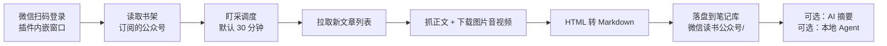

<div align="center">
  
</div>

<h1 align="center">
  
</h1>

<p align="center">
  <b>微信读书公众号盯采</b> · 一次扫码，把你书架里订阅的公众号文章，自动搬进 Obsidian。
</p>

<p align="center">
  <a href="README_EN.md">English</a> ·
  <a href="#三分钟上手">快速开始</a> ·
  <a href="#常见问题">常见问题</a> ·
  <a href="https://github.com/pixelxzen/Zisuzi-Weread-MP/issues">反馈问题</a>
</p>

<p align="center">
  <a href="https://github.com/pixelxzen/Zisuzi-Weread-MP/releases"></a>
  <a href="https://github.com/pixelxzen/Zisuzi-Weread-MP/releases"></a>
  
  
  <a href="LICENSE"></a>
</p>

---

公众号的文章，天生是「读完就散」的：散在订阅号信息流里、散在微信收藏里、散在转发到各个群的聊天记录里。
你想留住的那些长文、那些行业观察、那些写得比书还扎实的深度稿，最后大多只剩一个失效的链接。

**这个插件只做一件事，并把这件事做干净：把你微信读书书架里已经订阅的公众号，按你设定的节奏盯住，有更新就抓下来，连同图片和音视频，落成你自己的 Markdown 笔记。**

- 数据直连**你自己的**微信读书账号，不经任何第三方服务器中转
- 不碰微信客户端，不破解任何服务，不做账号池
- 全部免费（唯一的可选开销，是你自己配置的大模型 token）

```
微信读书书架  ──▶  插件盯采  ──▶  Obsidian 笔记库
  订阅的公众号        定时 / 手动        正文 + 图片 + 音视频 + 元数据
```

## 为什么值得装

| 你现在的处境 | 装上之后 |
|---|---|
| 想留存的文章躺在信息流里，翻两屏就再也找不到 | 按公众号归档，目录结构一眼看清楚 |
| 手动复制到 Obsidian，图片一张张丢 | 图片自动下载到本地 `assets/`，中文文件名也不出错 |
| 收藏了一堆链接，半年后全部 404 | 正文全文落盘，链接失效也不影响你手里的笔记 |
| 播客、视频号内容只能看不能存 | 音视频解析直链下载，用原生播放器嵌进笔记 |
| 想批量回看某个号的历史文章 | 单号全量归档，从新到旧整批抓，失败可单篇重试 |

## 功能

| | |
|---|---|
| **扫码登录** | 插件内嵌登录窗口，微信扫一下即可，不需要手工复制 Cookie |
| **书架即订阅源** | 自动读取你微信读书书架里订阅的公众号（几百个也能搜），勾选要盯的号 |
| **自动盯采** | 按设定间隔轮询，新文章自动落盘；状态条显示进度、倒计时、上次收了几篇 |
| **单号全量归档** | 把一个号的历史文章从新到旧整批抓下来，逐篇显示状态，失败可单独重试 |
| **正文完整归档** | HTML → Markdown；图片按魔数判真扩展名（微信 CDN 常把 PNG 挂在 `.jpg` 下） |
| **音视频落盘** | 解析直链并下载，用 `<audio>` / `<video>` 原生播放器嵌进笔记 |
| **四种视图** | 卡片网格 / 瀑布流 / 列表 / 纯标题，按需切换；左侧常驻公众号导航栏 |
| **两套主题** | Linear 中性 / 紫苏子品牌，一键切换 |
| **AI 处理** | 可接任意 OpenAI 兼容端点（内置 DeepSeek 等预设），对单篇做摘要、提炼金句、写评论，结果一键写回笔记 |
| **本地 Agent** | 可选调用本机 CLI（Hermes / Claude Code / Codex / Kimi / Gemini / Cursor）处理文章，不联网上传 |

> AI 处理与本地 Agent **默认全部关闭**，需要你显式开启并填入自己的 Key / 命令。



## 界面一览

<div align="center">
  
  <br />
  <sub>界面示意 · 示例数据。账号与文章均为虚构，实际界面以你安装的版本为准。</sub>
</div>

- **顶部**：登录状态 + 一站式操作（抓取一轮 / 全量归档 / 设置）
- **左侧**：公众号导航栏，勾选即盯，已归档篇数直接显示
- **中间**：卡片 / 瀑布流 / 列表 / 标题四种视图，文章卡片带归档状态
- **底部**：上次抓取结果、进度、下一轮倒计时，自动盯采状态一目了然

## 三分钟上手

**1. 安装**

`设置 → 第三方插件 → 浏览 → 搜索「Zisuzi-Weread-MP」` → 安装 → 启用。

手动安装：从 [Releases](https://github.com/pixelxzen/Zisuzi-Weread-MP/releases) 下载 `main.js`、`manifest.json`、`styles.css`，放进 `<你的库>/.obsidian/plugins/zisuzi-weread-mp/`，然后在「第三方插件」里重新加载并启用。

**2. 扫码登录**

`设置 → Zisuzi-Weread-MP` → 点 **扫码登录** → 在弹出的窗口里用微信扫一下。
登录成功后窗口自动关闭，头像、昵称、书架全部自动就位。

**3. 选号**

回到插件主界面，左侧勾选你要盯的公众号。几百个号也能直接搜。

**4. 开跑**

点 **抓取一轮** 立刻试一次；或打开 **自动盯采**，让它按间隔自己跑。

> 首次同步书架需要几秒到十几秒，取决于你订阅了多少个号。想先看效果，可以挑一个更新勤的号做「全量归档」。

## 抓取节奏：为什么它不「快」

公众号接口是微信读书的私有接口，**过度请求会触发风控**。插件内置的是偏保守的限速，默认值都经过实机验证：

| 参数 | 默认 | 说明 |
|---|---|---|
| 轮询间隔 | 30 分钟 | 下限 15 分钟；公众号发文是小时级，30 分钟已接近实时 |
| 每轮文章上限 | 6 篇 | 一次跑太多容易命中风控 |
| 单号每轮上限 | 2 篇 | 多号盯采时把请求摊开 |
| 列表间隔 | 1.2 秒 | 相邻两次列表请求之间 |
| 正文间隔 | 2.5 秒 | 相邻两次正文请求之间 |

命中风控码（`-2010` / `-2012` / `-2041`）时，插件**立即停止且不自动重试**。

> 请不要为了「快」把这些值改小。代价是你的微信号被限，不是插件崩了。

## 网络与隐私

插件只向你配置的服务发起请求。没有遥测、没有统计上报、没有远程下发代码。

| 域名 | 用途 |
|---|---|
| `weread.qq.com` | 登录、书架、公众号文章列表与正文、媒体直链 |
| `i.weread.qq.com` | 官方 Agent API（仅用于读取书架公众号清单） |
| `thirdwx.qlogo.cn` | 微信读书头像图片（下载到插件目录后显示） |
| 你配置的 LLM 端点 | 仅在启用「AI 处理」并主动点击时调用，默认关闭 |
| 你的本机 CLI | 仅在启用「本地 Agent」并主动点击时调用，默认关闭 |

- 登录凭据以明文保存在 `<库>/.obsidian/plugins/zisuzi-weread-mp/data.json`，**请勿把这个文件同步到公共位置**；退出登录会清空它。
- 使用「AI 处理」时，**文章正文会发送到你自己填的模型端点**。该功能默认关闭，需要你显式开启并填 Key。
- 「本地 Agent」默认关闭，只在点击时启动本机命令行进程。

## 已知限制

- 只能抓微信读书**已收录**的公众号文章（与所有同类方案同一边界），未收录的号抓不到。
- 纯图片型推送没有正文容器，会用摘要 + 封面写一篇短笔记，而不是整篇跳过。
- 接口属私有接口，可能变更；这是本插件的主要维护成本。
- **桌面端专用**（登录窗口依赖 Electron 的 `webview`，移动端暂不支持），需要 Obsidian 1.13.0 或更新版本。

## 常见问题

**Q：某个号明明订阅了，列表里却没有？**
先确认它在微信读书 App 里能被搜到、能读到文章。微信读书没收录的号，任何客户端方案都拿不到。可以试着在微信读书里打开一次该号任意文章，再回插件「重新同步书架」。

**Q：抓下来的笔记缺图？**
网络抖动或 CDN 限流会导致个别图片失败。在笔记上右键用「补全当前笔记的图片」，或用命令面板的「补全所有缺图笔记（批量重新采集）」。

**Q：提示登录态失效 / 抓取突然全失败？**
微信读书的网页登录态会过期。点 **退出登录**，再 **扫码登录** 即可；退出会停止盯采并清空旧凭据，不会动你已归档的笔记。

**Q：会不会把号跑封？**
插件用的是你本人的正常登录态，请求节奏按保守值限速，且命中风控立刻停手。只要你没有把间隔改到 15 分钟以下、没有开多份实例同时跑，风险与你自己在网页版翻文章相当。**但这是私有接口，没人能给你 100% 的保证。**

**Q：和我已经装的 Weread（划线同步）插件冲突吗？**
不冲突，两者读的是不同数据：那个插件同步书的划线和笔记，这个插件归档公众号文章。可以同时装。

**Q：能抓付费/付费专栏内容吗？**
不能。插件只归档你账号本身能正常阅读的文章。

## 开发

```bash
npm install
npm run dev      # 监听构建
npm run build    # 类型检查 + 生产构建
npm test         # 核心逻辑单测（需先构建 dist/core）
```

产物是仓库根目录的 `main.js` / `manifest.json` / `styles.css`。代码结构与踩坑复盘见 [`docs/`](docs/)。

## 反馈与贡献

- **Bug / 功能建议**：[Issues](https://github.com/pixelxzen/Zisuzi-Weread-MP/issues)（请附 Obsidian 版本、插件版本、`设置 → 第三方插件 → 调试` 里的报错）
- **PR**：欢迎。提交前请跑 `npm run build && npm test`，并保持 `eslint-plugin-obsidianmd` recommended 规则零告警。
- 这个插件会长期迭代：微信读书接口一变就要跟着修，所以你的 Issue 就是它的生命力。

## 致谢

- 交互与阅读面范式参考 [`joeseesun/qiaomu-ai-rss`](https://github.com/joeseesun/qiaomu-ai-rss)（GPL-3.0-only）
- 微信读书接口实践参考 [`zhaohongxuan/obsidian-weread-plugin`](https://github.com/zhaohongxuan/obsidian-weread-plugin)（MIT）

## Star History

<a href="https://star-history.com/#pixelxzen/Zisuzi-Weread-MP&Date">
  
</a>

## License

**GPL-3.0-only**

Copyright © 2026 Creative by [紫苏子ACG](https://github.com/pixelxzen)

---

<p align="center">
  <sub>用 Claude Code / Hermes Agent 与紫苏子ACG 一起打磨 · 如果它帮你留住了一篇好文章，欢迎在 Issues 里说一声。</sub>
</p>
