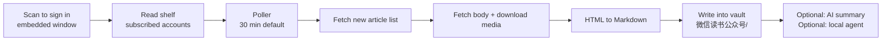

<div align="center">
  
</div>

<h1 align="center">
  
</h1>

<p align="center">
  <b>WeRead Official Account collector</b> · One QR scan, and every Official Account on your WeRead shelf lands in Obsidian as Markdown.
</p>

<p align="center">
  <a href="README.md">简体中文</a> ·
  <a href="#quickstart">Quickstart</a> ·
  <a href="#faq">FAQ</a> ·
  <a href="https://github.com/pixelxzen/Zisuzi-Weread-MP/issues">Issues</a>
</p>

<p align="center">
  <a href="https://github.com/pixelxzen/Zisuzi-Weread-MP/releases"></a>
  <a href="https://github.com/pixelxzen/Zisuzi-Weread-MP/releases"></a>
  
  
  <a href="LICENSE"></a>
</p>

---

Articles published on WeChat Official Accounts are built to disappear: buried in the subscription feed, lost in favourites, scattered across group chats. The long reads you meant to keep usually survive as one dead link.

**This plugin does one thing, and does it cleanly: it watches the Official Accounts already on your own WeRead shelf, saves new articles as they appear, and writes them into your vault as Markdown — images and media included.**

- Talks directly to **your own** WeRead account. No third-party relay server.
- Does not touch the WeChat client, does not break any service, keeps no account pool.
- Free. The only optional cost is the LLM tokens you configure yourself.

```
WeRead shelf  ──▶  plugin poller  ──▶  your vault
 subscribed accounts   manual / timed     text + images + audio + video
```

## Why it is worth installing

| What you deal with today | What you get |
|---|---|
| Articles you want to keep sink in the feed | One folder per account, easy to browse |
| Copy-paste into Obsidian loses every image | Images downloaded into a local `assets/` folder |
| Saved links 404 six months later | Full text on disk, immune to link rot |
| Podcast / video posts can only be watched | Direct media URLs downloaded and embedded with native players |
| No way to backfill an account's history | Full-archive per account, newest first, per-article retry |

## Features

| | |
|---|---|
| **Scan to sign in** | Embedded WeRead login window; scan once with WeChat. No cookie copying |
| **Your shelf is the subscription list** | Every Official Account on your WeRead shelf is listed and searchable |
| **Automatic collection** | Configurable poller saves new articles and shows progress, countdown and last-run results |
| **Full archive per account** | Backfill an account's history newest-first with per-article status and retry |
| **Faithful content** | HTML to Markdown; image extensions detected from magic bytes (WeChat CDN serves PNG under `.jpg`) |
| **Media saved locally** | Audio and video downloaded and embedded with `<audio>` / `<video>` players |
| **Four layouts** | Card grid, waterfall, list, title-only; persistent account sidebar |
| **Two themes** | Linear neutral or the Zisuzi brand theme |
| **Optional AI step** | Any OpenAI-compatible endpoint (DeepSeek preset included): summarise, extract quotes, draft a comment, write the result back into the note |
| **Optional local agent** | Call a CLI you already have (Hermes, Claude Code, Codex, Kimi, Gemini, Cursor). Nothing is uploaded |

> AI processing and the local agent are **off by default** and require your own key or command.



## Interface

<div align="center">
  
  <br />
  <sub>Interface illustration with sample data. Accounts and articles are fictional; the installed build is authoritative.</sub>
</div>

- **Top bar**: sign-in state plus one-click actions (fetch once / full archive / settings)
- **Sidebar**: account list, tick to track, archived count per account
- **Main area**: card, waterfall, list and title-only views, each article carrying its archive status
- **Status bar**: last run result, progress, next countdown, auto-collect state

## Quickstart

**1. Install**

`Settings → Community plugins → Browse → search "Zisuzi-Weread-MP"` → Install → Enable.

Manual: download `main.js`, `manifest.json`, `styles.css` from [Releases](https://github.com/pixelxzen/Zisuzi-Weread-MP/releases), drop them into `<vault>/.obsidian/plugins/zisuzi-weread-mp/`, then reload and enable.

**2. Sign in**

`Settings → Zisuzi-Weread-MP` → **Sign in with QR code** → scan with WeChat. The window closes itself; avatar, nickname and shelf load automatically.

**3. Pick accounts**

Back in the plugin view, tick the Official Accounts you want to track. The list is searchable, even with hundreds of entries.

**4. Run**

Press **Fetch once** to test, or enable **auto-collect** and let it poll.

> The first shelf sync takes a few seconds up to half a minute depending on how many accounts you follow.

## Fetch cadence: why it is not "fast"

The Official Account endpoints are WeRead's private APIs. Hammering them triggers rate controls. The defaults below were validated on real accounts:

| Parameter | Default | Notes |
|---|---|---|
| Poll interval | 30 min | Floor is 15 min; accounts publish hourly at best |
| Articles per run | 6 | Larger batches hit rate controls |
| Per-account per-run | 2 | Spreads requests across accounts |
| List delay | 1.2 s | Between consecutive list requests |
| Content delay | 2.5 s | Between consecutive article requests |

On rate-control codes (`-2010` / `-2012` / `-2041`) the plugin **stops immediately and does not retry**.

> Do not lower these values for speed. The cost is your WeRead account being throttled, not the plugin crashing.

## Network and privacy

The plugin only contacts the hosts below. No telemetry, no analytics, no remote code loading.

| Host | Purpose |
|---|---|
| `weread.qq.com` | Sign-in, shelf, article list and content, media URLs |
| `i.weread.qq.com` | Official Agent API (account list only) |
| `thirdwx.qlogo.cn` | WeRead avatar image |
| Your configured LLM endpoint | Only when you enable and trigger AI; off by default |
| Your local CLI | Only when you enable and trigger the local agent; off by default |

- Credentials are stored in plain text in `<vault>/.obsidian/plugins/zisuzi-weread-mp/data.json`. **Never sync that file to a public location.** "Sign out" clears it.
- With AI processing enabled, **the article body is sent to the endpoint you configured**. Off by default, requires your explicit opt-in and key.
- The local agent is off by default and only spawns a CLI process when you click.

## Limitations

- Only articles **already indexed by WeRead** can be archived — the same boundary every client-side tool hits.
- Image-only posts have no text container; they become a short note with summary and cover instead of being skipped.
- The endpoints are private and may change. That is the main maintenance cost of this plugin.
- **Desktop only** (the login window relies on Electron's `webview`), Obsidian 1.13.0 or newer.

## FAQ

**An account I follow is missing from the list.**
Make sure the account is searchable and readable inside the WeRead app itself. Accounts WeRead has not indexed cannot be reached by any client-side tool. Open any of its articles in WeRead once, then re-sync the shelf in the plugin.

**Some images are missing from a note.**
Network hiccups or CDN throttling. Use "Repair images of the current note" from the note menu, or the "Repair all notes with missing images" command.

**Login expired / every fetch fails suddenly.**
WeRead web sessions expire. Click **Sign out**, then scan again. Signing out stops collection and clears credentials; your archived notes are untouched.

**Can my account get banned?**
The plugin uses your own session at conservative delays and stops on the first rate-control response. Unless you drop the interval below 15 minutes or run several instances, the risk is comparable to browsing the web reader yourself. **These are private APIs — nobody can promise 100%.**

**Does it conflict with the Weread highlights plugin?**
No. That plugin syncs book highlights and notes; this one archives Official Account articles.

**Can it archive paid content?**
No. Only what your account can already read.

## Development

```bash
npm install
npm run dev      # watch build
npm run build    # typecheck + production build
npm test         # core unit tests (builds dist/core first)
```

Outputs `main.js` / `manifest.json` / `styles.css` at the repo root. Architecture notes and post-mortems live in [`docs/`](docs/).

## Contributing

- **Bugs / ideas**: [Issues](https://github.com/pixelxzen/Zisuzi-Weread-MP/issues) — include Obsidian version, plugin version and the error from `Settings → Community plugins → Debug`.
- **PRs**: welcome. Run `npm run build && npm test` and keep `eslint-plugin-obsidianmd` recommended at zero warnings.

## Credits

- Interaction and reading-surface patterns inspired by [`joeseesun/qiaomu-ai-rss`](https://github.com/joeseesun/qiaomu-ai-rss) (GPL-3.0-only)
- WeRead API practice informed by [`zhaohongxuan/obsidian-weread-plugin`](https://github.com/zhaohongxuan/obsidian-weread-plugin) (MIT)

## License

**GPL-3.0-only**

Copyright © 2026 Creative by [紫苏子ACG](https://github.com/pixelxzen)
